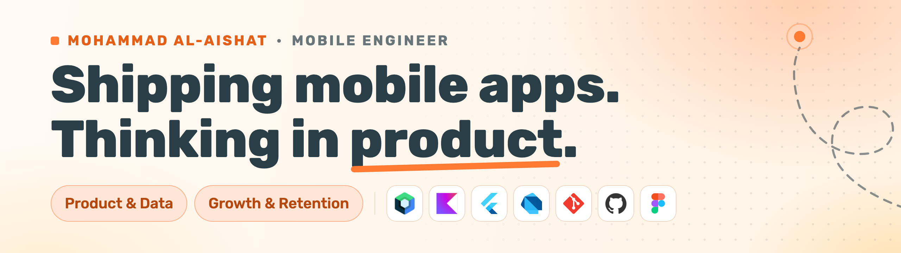

<picture>
  <source media="(prefers-color-scheme: dark)" srcset="assets/banner-dark.png">
  
</picture>

### Hi, I'm Mohammad 👋

Mobile Engineer at **[BeeOrder](https://www.beeorder.com)**, a food-ordering app in Syria. I build the customer app with **Flutter** and **Android (Kotlin)**, and work on product & data for growth and retention.

2+ years shipping apps in real estate, sports, medical and e-commerce. 4th-year **AI** student at Damascus University.

### Selected work

- **[AqarGo](https://github.com/MohammadMarwan2005/aqar-go)**: real-estate marketplace app, with its own [backend](https://github.com/MohammadMarwan2005/AqarGo-Backend). `Flutter` `Laravel`
- **[Pharma AI](https://github.com/MohammadMarwan2005/pharma-ai)**: identifies medicines by scanning the drug box. `Flutter` `AI`
- **[Docdoc](https://github.com/MohammadMarwan2005/clean.docdoc)**: doctor-booking app on clean architecture (practice project). `Kotlin`
- **[High-Performance E-Commerce](https://github.com/MohammadMarwan2005/High-Performance-E-Commerce)**: concurrency-focused e-commerce backend. `Spring Boot`

🧉 Fun fact: I can't live without mate.
